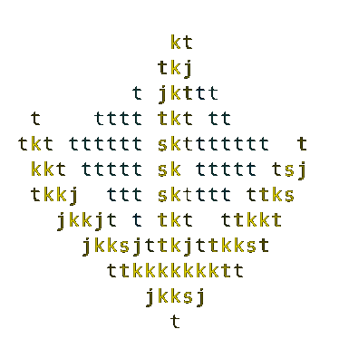

# Footup MVC PHP Framework

<div align="center">
  
  <h2 class="name_title">FOOTUP MVC FRAMEWORK - 1.0.0-beta</h2>
</div>

<p align="center">
    <a href="https://twitter.com/intent/follow?screen_name=JohnnyFaustfizz">
      
    </a>
    <a href="https://github.com/faustfizz/footup/">
      
    </a>
    <a href="https://github.com/badges/shields/pulse" alt="Activity">
      
    </a>
    <a href="https://github.com/faustfizz/footup/releases">
      
    </a>
    <a href="https://github.com/faustfizz/footup/releases">
      
    </a>
    <a href="https://github.com/faustfizz/footup">
      
    </a>
    <a href="https://github.com/faustfizz/footup">
      
    </a>
    <a href="https://github.com/faustfizz/footup">
      
    </a>
</p>


A Rich Featured LightWeight PHP MVC Framework :

* CLI support for generating **Controller**, **Model**, **Middle**, **Migration**, **Seeder**, **Assets** and **View** files ( [adhocore/php-cli](https://github.com/adhocore/php-cli) modified and used thanks :) )
* Translation support
* Config using PHP File or .env (Rename env to .env)
* Request
* Response
* Validator (Form Validation - Not validating UploadedFile) Thanks to [pdscopes/php-form-validator](https://github.com/pdscopes/php-form-validator)
* Pagination (Pagination and Pagination View) Thanks to [iranianpep/paginator](https://github.com/iranianpep/paginator)
* Session
* Email (CodeIgniter 4 Email Class)
* Routing
* Controller AND Middleware (But here we call it just Middle and are specific)
* Model RelationShips ($hasOne, $hasMany, $belongsTo, $belongsToMany)
* Model QueryBuilder
* Model Events CallBacks
* Files (Upload File)
* Extensible (You can integrate any library you want and you can add (news folders and class) in the App Directory using psr4 autoloading mecanism)

## Project structure

```text
.
├── app/
│   ├── bootstrap.php
│   ├── controllers/
│   ├── models/
│   ├── requests/
│   └── routes.php
├── bin/
│   └── console.php
├── config/
│   ├── app.php
│   ├── database.php
│   └── services.php
├── core/
│   ├── Application.php
│   ├── Benchmark.php
│   ├── Connection.php
│   ├── Container.php
│   ├── DB.php
│   ├── Env.php
│   ├── helpers.php
│   ├── HttpException.php
│   ├── Model.php
│   ├── QueryBuilder.php
│   ├── Request.php
│   ├── Response.php
│   ├── Router.php
│   ├── Route.php
│   ├── View.php
│   └── autoload.php
├── database/
│   └── migrations/
├── public/
│   ├── .htaccess
│   └── index.php
├── storage/
│   └── logs/
├── views/
├── .env.example
├── composer.json
├── composer.lock
├── phpunit.xml
└── README.md
```

## Requirements

- PHP 8.1+
- Composer (optional, but recommended)
- SQLite support in PHP

## Quick start

```bash
cp .env.example .env
composer install
php bin/console.php migrate
php bin/console.php serve
```

Then open:

- http://localhost:8000/
- http://localhost:8000/welcome
- http://localhost:8000/ping
- http://localhost:8000/api/users

## Environment configuration

The app reads configuration from `.env` files and loads them through the framework config layer.

Example:

```env
APP_ENV=local
APP_DEBUG=true
DB_CONNECTION=sqlite
DB_DATABASE=database.sqlite
```

You can also set MySQL/PostgreSQL values if needed. The `config/database.php` file already includes the common connection variables.

## App bootstrap

Application startup is centralized in `app/bootstrap.php`.

This is where you:

- register routes
- attach middleware
- bind services to the container
- configure app-level behavior
- define custom exception handling

Example:

```php
$app->routes(function () {
    Route::get('/', [HomeController::class, 'index']);
    Route::get('/welcome', [WelcomeController::class, 'index']);
});
```

## Routing

Routes are defined with the framework router and can take path parameters.

```php
use Footup\Facades\Route;

Route::get('/hello/{name}', function ($request, $name) {
    return json(['hello' => $name]);
});
```

You can also define grouped routes and attach middleware at the route or app level.

## Controllers and views

Controllers live under `app/controllers/` and can return JSON, redirect responses, or render views.

Typical flow:

```php
final class HomeController extends Controller
{
    public function index(): Response
    {
        return view('home', ['name' => 'Footup']);
    }
}
```

Views live in `views/` and are plain PHP templates.

## Database

SQLite is enabled by default and requires no setup beyond creating the database file.

Run migrations:

```bash
php bin/console.php migrate
```

Then query the app via the API, for example:

```bash
curl -X POST localhost:8000/api/users \
  -d name="Ada Lovelace" \
  -H "Authorization: Bearer secret-token"

curl localhost:8000/api/users
```

### Query builder

```php
use Footup\DB;

DB::table('users')->where('name', 'like', '%Ada%')->get();
DB::table('users')->insert(['name' => 'Grace Hopper']);
```

### Models

```php
final class User extends \Core\Model
{
    protected static string $table = 'users';
}

User::all();
User::find(1);
$user = (new User(['name' => 'Grace Hopper']))->save();
```

### Migrations

Migrations live in `database/migrations/` as SQL files. Files are applied in order by filename and tracked in a `migrations` table.

```bash
php bin/console.php migrate
```

This project intentionally keeps migrations simple: plain SQL, no rollback support, and no complex migration DSL.

## Logging

The app includes a lightweight logger.

```php
logger('User logged in', ['id' => $user->id]);
```

Logs are written to `storage/logs/app.log`.

## Exceptions and error handling

Unhandled exceptions are caught by the framework and can be customized from `app/bootstrap.php`.

A commented example exists for a custom HTML exception handler.

## Timing and benchmarking

The framework includes request timing instrumentation.

```bash
curl -I localhost:8000/welcome
```

You will see headers such as:

```text
X-Response-Time: 3.42ms
Server-Timing: view_home;dur=1.87, total;dur=3.42
```

You can also benchmark routes from the CLI:

```bash
php bin/console.php bench /welcome 100
```

This runs the route in-process and reports timings without the overhead of a real network round trip.

## CLI commands

```bash
php bin/console.php serve
php bin/console.php migrate
php bin/console.php route:list
php bin/console.php bench /welcome 100
```

## Notes

This project is intentionally compact and framework-like rather than full-stack framework heavy. It is meant to be a readable base for small apps, prototypes, and internal tools.